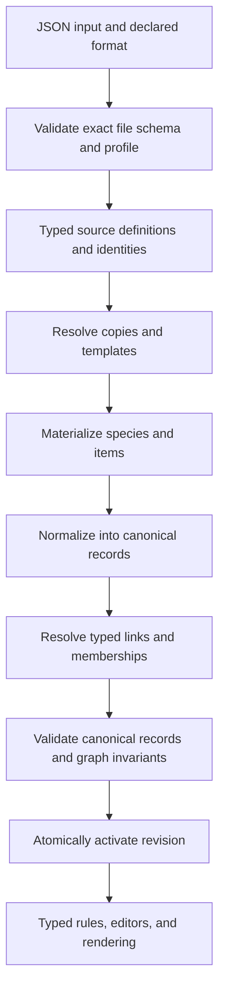

# Schema-driven importer and adapter overhaul

Status: the migration of existing consumers is complete through the final cleanup and priority reference/template fixes (adapter 22). Pinned source validation, expanded import coverage, canonical mechanical/selection fields, and shared proficiency/entry/spell-reference consumers are implemented. All ten import-only reference categories, including statuses, now have typed stored definitions after copy resolution. Reusable item entries and item-property templates are expanded, and weapons without a single damage type retain relative variant descriptions; generated references prefer the requested rules edition, and standard species references prefer their playable form over the exact base definition. Unused metadata and materialization inputs intentionally remain source-shaped; unsupported automation and new UI remain out of scope. See [implementation coverage and verification](SCHEMA_CONTENT_COVERAGE.md) for exact fields, compatibility boundaries and limitations.

The user confirmed manual browser acceptance on 2026-10-21 for import, basic character creation, sample correctness across content types, export/import, offline saving, sync and performance. The agreed migration scope is accepted; see [manual acceptance results](SCHEMA_CONTENT_COVERAGE.md#manual-browser-acceptance-2026-10-21), including the reported site-wide storage measurement.

For the information now available and possible future sheet uses, see [Information gained and sheet opportunities](SCHEMA_INFORMATION_AND_SHEET_USES.md).

## Objective

Make imported content deterministic, readable, and validated throughout the application. Interpret documented upstream alternatives once, then give rules, editors, rendering, and persistence an explicit application contract. Remove speculative fallbacks without removing genuine schema alternatives, user choices, or compatibility at external boundaries.

The schemas describe structure, not every rule of inheritance, UID defaulting, expression evaluation, or game behavior. Structural validity and supported automation are separate checks. A schema-valid record must never acquire invented mechanics simply to fit the application model.

## Confirmed implementation scope

These decisions were confirmed by the user after the initial plan:

- **Pinned schemas and explicit mappings:** validate against a reviewed schema snapshot and implement readable mappings for its declared structures. Do not look up live schemas during imports. Generate types and validators where useful; mapping semantics remain intentional application code.
- **Expanded import coverage:** retain currently supported content and its required dependencies, and also import the categories below. Give the additions validated source types, canonical records, deterministic identities, applicable copy/reference handling, and persisted storage so future features can consume them directly.
- **No new editor or viewer exposure:** the additional categories are import/storage work only. Do not add their selectors, editor controls, sheet sections, or dedicated rendering workflows. Preserve existing condition and variant-rule integrations while migrating their contracts; their inclusion here does not authorize additional UI.
- **Automation scope:** support every relevant schema-defined data shape, with new automation limited to fields the existing rules already attempt to handle. Represent other mechanics faithfully and report unavailable automation explicitly. Importing the additional categories does not authorize new game-rule automation for them.
- **Mandatory reimport:** a new import of installed content libraries is acceptable and required at cutover. Do not build migrations for every old cached intermediate representation. Saved characters still require explicit snapshot migrations and must preserve notes, authored values, overrides, resource usage, and offline access without requiring a download.

| Requested category | Core file / schema | Canonical source category |
| --- | --- | --- |
| Actions | `actions.json` | `action` |
| Bastions | `bastions.json` | `facility` (the upstream name for bastion facilities) |
| Conditions and diseases | `conditionsdiseases.json` | `condition`, `disease` |
| Objects | `objects.json` | `object` |
| Senses | `senses.json` | `sense` |
| Skills | `skills.json` | `skill` |
| Variant rules | `variantrules.json` and the existing generated-file route | `variantrule` |
| Vehicles | `vehicles.json` | `vehicle` |

Apply the corresponding brew contracts when these categories occur in homebrew files. Audit supporting categories such as `vehicleUpgrade` for required dependencies. Statuses were additionally authorized and imported in adapter 21. Other categories sharing these files remain explicitly reported exclusions unless required as dependencies; importing one category does not silently expand scope to every root property.

## Findings from the local repositories

The inspected schema checkout is `D:\5etools-utils`, package version `0.17.23`, commit `69490c8ef4c3dc83f4714bfec3a187e70cd25a7b`.

- Use compiled `schema/site` for the core corpus and `schema/brew` for homebrew. `schema/ua` is a distinct profile; add it only through an explicit supported input route. Do not try profiles until one happens to pass.
- `schema-template` contains preprocessor extensions, including conditional site/brew/UA definitions. It is useful explanatory material, not validator input.
- Use full compiled schemas as the validation authority. The `*-fast` versions omit conditional checks during compilation and must not define import acceptance.
- Schemas use JSON Schema draft 2020-12, cross-file references, per-file versions, unions, nullable copy overrides, and some deliberately open objects. Source vocabularies differ between profiles.
- Upstream `lib/UtilAjv.js` uses Ajv2020, union types, formats, annotation keywords, a custom date check, and decimal-safe `multipleOf`. Validator generation must account for those details.
- The application currently has `ADAPTER_VERSION = 8`. `ContentRecord.kind` is a string and `data` is a `JsonObject`; strict TypeScript therefore cannot narrow payloads by kind.
- Existing staging, atomic activation, commit-pinned downloads, cancellation, dependency scopes, and copy parity tooling provide a useful foundation. Extend those mechanisms.

| Current code | Opportunity / constraint revealed by the schema |
| --- | --- |
| `content-adapter.ts`: general name/source fallbacks for every kind | Define identity and display-name rules per category. Some names really are optional, such as item definitions; display labels and logical identities need distinct contracts. Copy-only branches need resolution before requiring full fields. |
| `inheritCopy`: `_mod ?? mod` | The inspected copy contract defines `_mod`. Remove the `mod` alias from schema-validated input; handle any supported historical input in a named migration. |
| `spell-membership.ts`: accepts overlay, inline, and Android forms | These are different input formats. Give each an explicit decoder and expose one membership shape internally. |
| `editor-content-helpers.ts`: searches serialized `primaryAbility` for abbreviations | `primaryAbility` is an array of objects with ability flags. Read those fields explicitly while preserving the meaning of alternatives. |
| `normalizeSpecies`, `speciesSnapshot`, and `projectSheet`: reshape movement repeatedly | Normalize movement once; perform any Android conversion only at the compatibility boundary. |
| `ability-rules.ts`: handles only simple choices | Ability definitions also permit weighted choices, `entry`, `hidden`, and `max`. Account for each rather than rejecting or guessing from observed examples. |
| `species-rules.ts`: expects every movement field to be a numeric mode | Speed also permits `Varies`, `true` mode values, conditions, hover metadata, alternate speeds, hidden modes, and choices. They cannot all become unconditional numbers. |
| `items-base.json` import | The upstream root also declares `itemEntry` and `itemTypeAdditionalEntries`, which are absent from the current category list. Audit their dependencies and rendering use before discarding them. |
| `conditionsdiseases.json` import | The schema declares `condition`, `disease`, and `status`; the adapter currently imports only `condition`. Add `disease` under the confirmed scope and report other excluded categories explicitly. |
| Native character validation | Snapshot payloads currently receive only broad object checks. The new contract must also apply when saved characters enter through storage, sync, or sharing. |

## Proposed contracts

Use two intentional representations:

1. **Validated source types**, matching a pinned upstream schema profile, including its real unions and optionality. Generate these from the selected schema dependency graph; document any generator limitations or reviewed overrides.
2. **Canonical application types**, written for readability and narrowed by a literal `kind`. Normalize upstream alternatives into explicit variants where that makes consumers simpler. Do not introduce layers that merely rename identical fields.

For example, checking `record.kind === 'spell'` must expose a spell payload with a numeric level and typed range, duration, components, entries, and memberships. Checking for a species must expose typed movement, defenses, senses, and ability alternatives. Known fields must allow direct property access rather than `data['field']`, `object(...)`, and assertions through `unknown`.

Common metadata should cover stable identity, publication, origin, and typed links. Kind-specific fields stay in kind-specific payloads. Use open maps only for genuine dictionaries, schema-sanctioned extensions, and user-authored extension data. Avoid a universal optional-field interface or catch-all union member that defeats narrowing.

Keep source definitions and derived records distinct. A raw race/subrace, playable species, magic-variant recipe, and generated item have different invariants; derived fields such as provenance must not be validated against the original file schema.

Examples of canonical normalization:

- Bare and object feature references become one typed reference, retaining flags such as subclass feature timing.
- Fixed and weighted ability choices become distinct variants. Defaults come from documented upstream semantics, not validator mutation or invented values.
- A numeric speed becomes a fixed walk speed. Conditional, variable, alternative, and choice-based movement remain distinct variants; hover is metadata. A mode value of `true` requires an explicit semantic interpretation, never numeric coercion.
- Overlay and inline spell memberships become one typed membership structure; Android membership arrays are decoded separately.
- Text and structured entries become an explicit entry tree with typed table rows, cells, references, lists, and options. Preserve annotations and presentation information needed by the renderer.
- Item inheritance resolves mechanical fields with a documented precedence. Property/type/mastery definitions remain references; repeated presentation expansion need not be stored on every item.

## Import and validation flow

The stages are logical boundaries; retain file-by-file processing and paged database traversal. Do not require the full library in memory. Source validation happens before source definitions enter staging. Intermediate staging rows must have an explicit stage/type and remain invisible to active-library consumers.

- Select core validators through an explicit file registry, including class/spell/bestiary index families, templates, `spells/sources.json`, and all files in the confirmed expanded import scope. Extend discovery and category registration together. Validate discovery indexes before using them.
- The inspected schema checkout has no generated schemas named `gendata-variantrules.json` or `gendata-tables.json`, although the importer downloads those paths. Verify whether their documents conform to the existing variantrule/table schemas; otherwise define narrowly scoped, documented local contracts. Do not claim validation coverage based on the filename alone.
- Validate homebrew against the brew document contract and its reference graph. Preserve schemas' actual `additionalProperties` behavior. Report valid categories outside supported application scope; never silently treat them as imported content.
- Do not enable coercion, automatic property removal, or automatic defaults. A string where an integer is required is an input error.
- Validate resolved transformations and canonical output before activation. Check identity consistency, duplicate identities, kind-correct targets, required links, cycles where prohibited, generated provenance, and unresolved copy instructions.
- Make diagnostics structured: code, phase, severity, file, record identity/index, JSON Pointer, schema path, and message. Replace severity decisions based on matching English error text.
- Define policy by issue type: malformed input and failed required transformations block activation; optional description references may warn; user choices remain choices. Missing external homebrew dependencies must be visible and must prevent affected automation from being treated as complete.
- Preserve the prior active revision on failure. Extend rollback/cancellation tests to validation and conversion failures.

## Delivery sequence

### 1. Inventory and establish the baseline

Create a checked-in field/branch coverage matrix for every currently supported kind, the confirmed additional import categories, and all fields existing consumers use. For import-only categories, cover their canonical storage contract and applicable dependencies even though they have no new UI consumers. Each entry records schema profile/path, legal forms, requiredness, defaults with a semantic source, canonical destination, support status, consumers, and tests. Mark fields as mapped, deliberately retained, excluded with a reason, or unsupported with a diagnostic.

Audit schema branches rather than only sample records: copy variants, null removal, additional spells, prerequisites, proficiency choices, entries, item recipes, and monster mechanics. Trace content payloads through rules, editor selection, character projection, sheet helpers, storage, and export.

Use an explicitly pinned content commit for comparison. Existing migration documents describe adapter version 6 and an older corpus; their measurements are historical, not a current baseline. Capture import validity, diagnostics, counts by kind, stored bytes, worker bytes, initial bundle bytes, import time, and representative character results under version 8. Record schema/content mismatches before deciding whether the pins belong together.

Report the cost of newly imported categories separately from changes to existing categories, so expanded coverage does not obscure redundancy or performance improvements.

**Exit:** an auditable scope/coverage matrix and reproducible baseline, with no unexplained schema failures or implied support for unimplemented branches.

### 2. Add reproducible schema tooling and validators

Vendor the required full schema dependency closures for site and brew with license attribution and a manifest containing repository commit, package/file versions, and checksums. Treat `D:\5etools-utils` as the source for this integration, not a permanent machine-specific build dependency. Keep profiles in separate validator registries so duplicate relative schema IDs cannot collide.

Add deterministic build tooling that generates source types and validator artifacts. Preserve relative reference resolution, recursive entries, optionality, and genuine unions. Run a small generation spike first: site/brew feature definitions, recursive entries, copy branches, and speed/ability unions must compile and validate correctly.

Prefer precompiled validators loaded by the content worker so the browser does not compile schemas during import. Verify standalone generation can reproduce upstream custom format and numeric checks; use code-generation-compatible implementations and parity fixtures if required. Do not silently weaken validation to make code generation succeed. Verify the tradeoff before committing the complete artifact set.

Add generation drift checks. Schema updates are explicit manifest/type/validator/coverage changes; imports never fetch a newer schema automatically.

**Exit:** reproducible artifacts, validator parity for relevant custom behavior, correct site/brew separation, and a measured worker/initial-bundle impact.

### 3. Establish the canonical contract with one complete slice

Introduce the kind-to-payload map/discriminated record union, typed references and provenance, canonical runtime validation, and explicit source/resolved/canonical stage types. Keep canonical validation and TypeScript declarations synchronized through a defined generation or contract-checking mechanism.

Use species as the first complete slice: source validation, copies, race/subrace merging, canonical movement and ability choices, rule consumption, editor selection, viewer presentation, and saved snapshot validation. Include weighted choices and nonnumeric movement from the start; make support gaps explicit rather than accepting only the common branch.

**Exit:** the slice can import, select, save, reopen, and render without downstream shape probing or data loss. Its malformed and schema-valid uncommon branches have defined outcomes.

### 4. Migrate the remaining content families and consumers

For each existing family, land its source decoding, transformations, canonical validation, all consumers, and removal of superseded fallbacks together. For import-only additions, complete the data pipeline and storage contract without introducing editor/viewer consumers.

| Order | Content family | Main consumers / required work |
| --- | --- | --- |
| 1 | Classes, subclasses, features, feats, optional features, backgrounds | Feature/level/ability/proficiency rules, prerequisites, optional progression, class wizard, source ability flags, feature/background editors. Decode feature references once, with typed ownership and levels. |
| 2 | Spells, additional-spell grants, memberships, selectors | Spell/casting/filter/choice/usage rules, membership indexes, spell editor and sheet. Preserve level gates, counts, usage expressions, abilities, expanded lists, and user choices. |
| 3 | Base items, items, groups, variants, type/property/mastery and needed entry definitions | Materializer, item resolver, item catalog/selection, combat armor/actions, equipment page. Replace string-property helpers and repeated base/item field fallbacks with a typed item view. |
| 4 | Monsters and templates | Copy operations/variables, monster selection/editor, stat blocks, actions and spellcasting presentation. Keep nonnumeric/conditional mechanics explicit. |
| 5 | Existing conditions, variant rules, tables, shared entries and metadata | Migrate existing catalogs, descriptions, reference traversal, entry renderer, and sheet consumers. Audit all permitted entry forms and intentional exclusions without expanding their UI scope. |
| 6 | Import-only additions: actions, bastion facilities, diseases, objects, senses, skills, vehicles, and coverage of requested conditions/variant rules | Add file discovery, site/brew validation, typed records, identities, applicable copy/dependency handling, and persistence. Verify the complete requested category list is imported and retrievable. Do not add editor/viewer workflows or automation for these additions. Standalone `action` records are distinct from monster action fields. |

Shared entries, references, copy operations, and expressions start as foundations and expand with each family. Replace generic recursive guessing with schema-defined traversal where possible. Retain dynamic traversal where the schema actually permits dynamic property paths or arbitrary entry payloads.

Make copy operations a typed `mode` union and audit every permitted mode, including ones absent from the baseline corpus. Shape knowledge does not establish copy semantics: retain/extend `audit-copy-parity.mjs` against pinned upstream behavior for preservation, null removal, modifier ordering, templates, expressions, variant matching, and subrace merging.

Rules should read domain fields, not call adapter parsing helpers. They still validate player selections, ownership, limits, and unsupported automation. `session-rules.ts` already operates on typed play state; update the definitions feeding its resource pools as needed and preserve its state/action validation.

**Exit per family:** every relevant schema branch has an implementation or an explicit capability outcome; all family consumers use the canonical contract; obsolete speculative branches and duplicate converters are deleted.

For import-only additions, the exit condition is validated, deterministic, retrievable stored content with explicit dependency/capability diagnostics and no new editor/viewer exposure.

### 5. Carry the contract through persistence and compatibility

Update `content-cache`, homebrew replay, dependency snapshots, `character-document`, editor projection, character repositories, cloud decoding/sync/sharing, and import/export boundaries. Version the canonical format separately from the upstream schema snapshot and adapter behavior; store their identities on revisions and relevant character bindings.

- Require a fresh core-library import at cutover and build a new validated revision; old core cache rows do not need an in-place format migration. Retain the previous revision for rollback, but do not serve incompatible rows through the new canonical API. Present an explicit reimport requirement wherever a library-dependent workflow needs the new format.
- Homebrew append/replay may reuse core rows only when their canonical/adapter versions are compatible; it must not relabel old rows as the new format. Validate and replay retained homebrew source files through the new pipeline when rebuilding the library.
- Existing character snapshots need explicit versioned migrations and runtime validation. Reopening a character must work offline without looking up newer library content.
- Retain old snapshot decoders only in a compatibility module. Never reintroduce old payload unions throughout the application.
- Keep Android input/output conversion separate from core/brew adapters. Preserve authored values, notes, manual rules overrides, session usage, and publication bindings.
- If an old snapshot cannot be converted losslessly, retain its original content and expose a specific migration/capability issue. Do not replace it automatically from the current catalog.
- Snapshot deduplication must preserve stable instance IDs and origins; changing a content key must not reset resources or detach annotations.

**Exit:** old/new native and Android fixtures survive save/load and export/import with their authored and session state preserved; shared/synced payloads cannot bypass canonical validation.

### 6. Remove redundancy, measure, and finish the cutover

Use one canonical payload per record plus required provenance. Keep homebrew source documents once per installed file for replay; avoid also embedding raw and normalized duplicates on every entity. Any source archive needed for diagnostics or future migrations stays outside normal runtime records. Preserve schema-valid information before considering storage cuts.

Audit duplicate metadata and links, repeated item descriptions, generated variants, and repeated character snapshots. Keep index fields when their storage cost buys useful queries. Measure eager versus lazy variant generation before changing the existing materialization strategy; schema knowledge alone does not establish which is cheaper.

Keep generated validators out of the initial application bundle where possible. Type declarations add no runtime validation cost, but normalization and validator code may increase worker size; report actual changes instead of promising savings.

Remove unused generic helpers, unsafe casts on imported content, duplicated shape checks, unsupported aliases, and temporary migration bridges outside the compatibility boundary. Retain defensive validation at trust boundaries and checks of mutable player state.

**Exit:** complete consumer audit, reproducible before/after measurements, no undocumented payload escapes, and clear schema-update instructions.

## Verification and completion criteria

- Build a fixture inventory tied to the coverage matrix: valid uncommon branches plus malformed required fields, enum values, nulls, and references. Schema validation is necessary, but semantic fixtures must assert the meaning of transformations too.
- Test identical source bytes/profile/adapter version for identical canonical records and stable ordering/identities, excluding revision UUIDs, timestamps, and timing metrics. Do not reorder arrays whose order carries meaning.
- Exercise import cancellation, invalid later files, duplicate identities, copy cycles, generated failures, incompatible homebrew append, and activation rollback.
- Compare old/new mechanical output and selected rendering on the same pinned corpus; investigate every difference and distinguish intended corrections from regressions.
- Test weighted ability choices, conditional/variable/alternate movement, spell grants and memberships, item variants and property definitions, monster templates, and structured entry forms.
- Verify every confirmed additional category can be imported, validated, stored, and retrieved, including brew input and applicable copy/dependency cases. Assert that no new editor/viewer category exposure is introduced.
- Test mandatory reimport detection for incompatible libraries, failed-reimport rollback, and homebrew replay through the new pipeline. Existing character snapshots must remain usable offline independently of the library reimport requirement.
- Test persistence and compatibility with detached snapshots, including resource usage and notes. Validate native snapshot data at load/decode boundaries, then use typed values internally.
- Run focused suites during each family migration, then `npm test -- --watch=false` and `npm run build` for the integrated cutover. Extend the existing content probe and browser acceptance scripts for import diagnostics and representative character/equipment workflows.
- Compare initial bundle, worker chunks, real IndexedDB bytes, import duration, and browser memory on the same corpus/environment. Report Node probe measurements separately from browser measurements. Preserve file-wise/paged processing and existing build budgets; document any measured tradeoff.
- Completion means all imported-content consumers are covered, not just `content-adapter.ts`. New schema versions require an explicit compatibility audit and generated-artifact update.

The first implementation deliverable should be the schema/consumer coverage matrix, reproducible schema snapshot, and validator generation spike. That establishes the contract before changing saved data or deleting compatibility code.

## Ability-score automation scope

Imported species ability adjustments remain part of the canonical species definition and the self-contained character snapshot. A pure allocation helper may be maintained and tested, but live character calculations must not invoke it yet. Manually entered ability scores drive HP, prerequisites, derived statistics, and sheet projection. Existing `applySpeciesAbilities` flags and saved derived ability scores do not enable automation or override manual scores. Enabling this behavior requires a future explicit implementation decision.
